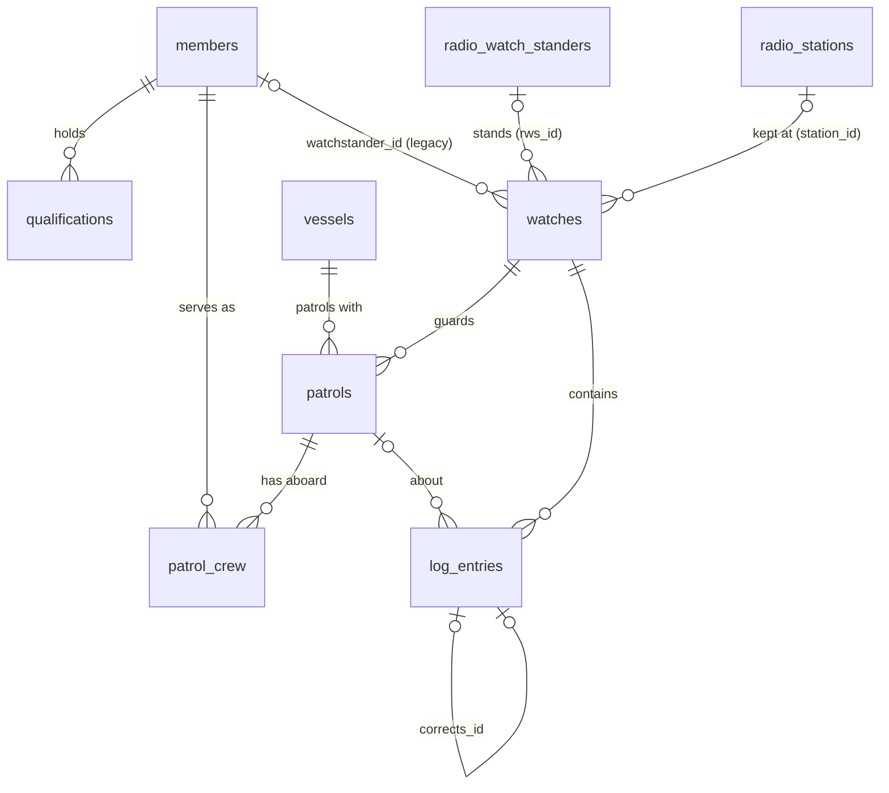

# VHF Communications Watch Log: Database Schema

- **Engine:** SQLite 3, using Python's standard `sqlite3` module.
- **Foreign keys:** turned on for every connection (`PRAGMA foreign_keys = ON`).
- **Schema version:** 5, stored in `meta.schema_version`.
- **Where it is defined:** the `SCHEMA` string in `watchdb.py`. The migrations are in `WatchDB._migrate()`.
- **File location:** `%APPDATA%\N. Tesla\VHF Watch Log\watchlog.db`.

> The database holds member names and phone numbers (PII). It is never committed to git
> or shipped in the setup zip.

## Conventions

| Item | Convention |
|---|---|
| Times | Stored as UTC ISO-8601 text with a `Z` suffix, for example `2026-11-09T14:32:00Z`, in every `*_utc` column. They are shown in both UTC and local time. |
| Dates | ISO `YYYY-MM-DD` text, for example `as_of`, `tco_date` and `inspection_expires`. An empty string `''` means unknown. |
| Booleans | `INTEGER` 0 or 1, for example `active`, `locked`, `struck` and `trainee`. |
| Missing text | Text columns are `NOT NULL DEFAULT ''`, so blank means empty, not NULL. NULL is used only for optional foreign keys, open-ended times and coordinates. |
| Soft delete | Reference tables (vessels, members, watch standers, stations) use `active = 0` instead of deleting rows. |

## Entity relationships

These tables stand on their own, with no foreign keys: `meta`, `settings`, `patrol_types`, `channels` and `contacts`.
`patrols.mission` holds the patrol type's name as text, not a key (see `patrol_types`).

---

## Tables

### meta
Internal bookkeeping for the program.

| Column | Type | Constraints | Notes |
|---|---|---|---|
| key | TEXT | PRIMARY KEY | `schema_version` |
| value | TEXT | | `5` |

### settings
Station settings, stored as key/value pairs.

| Column | Type | Constraints | Notes |
|---|---|---|---|
| key | TEXT | PRIMARY KEY | |
| value | TEXT | | |

| Key | Default | Meaning |
|---|---|---|
| station_call_sign | `Amelia 9` | Call sign used when a watch has no radio station |
| default_channel | `83A` | Channel filled in when a watch opens |
| ops_interval_min | `30` | Minutes between ops-normal checks |
| due_soon_min | `5` | Minutes before a check is due when it is flagged "due soon" |
| print_cell_numbers | `1` | Whether printed logs include crew and vessel cell numbers |
| incident_name | `Patrol communications guard` | Incident name on the ICS 309 Communications Log |

### vessels
Auxiliary facilities (boats and PWCs).

| Column | Type | Constraints | Notes |
|---|---|---|---|
| id | INTEGER | PRIMARY KEY | |
| facility_no | TEXT | NOT NULL, UNIQUE | Auxiliary facility number |
| name | TEXT | NOT NULL DEFAULT '' | |
| call_sign | TEXT | NOT NULL DEFAULT '' | Radio call sign |
| cell | TEXT | NOT NULL DEFAULT '' | Cell phone aboard |
| owner | TEXT | NOT NULL DEFAULT '' | |
| description | TEXT | NOT NULL DEFAULT '' | Make, length, colour |
| mmsi | TEXT | NOT NULL DEFAULT '' | |
| inspection_expires | TEXT | NOT NULL DEFAULT '' | YYYY-MM-DD |
| active | INTEGER | NOT NULL DEFAULT 1 | |

### members
Auxiliarists who can serve as boat crew. **Contains PII.**

| Column | Type | Constraints | Notes |
|---|---|---|---|
| id | INTEGER | PRIMARY KEY | |
| member_no | TEXT | NOT NULL, UNIQUE | Member (EMPLID) number |
| last_name | TEXT | NOT NULL | |
| first_name | TEXT | NOT NULL DEFAULT '' | |
| phone | TEXT | NOT NULL DEFAULT '' | |
| active | INTEGER | NOT NULL DEFAULT 1 | |

### qualifications
One row for each qualification a member holds.

| Column | Type | Constraints | Notes |
|---|---|---|---|
| member_id | INTEGER | NOT NULL, FK → members(id) | |
| qual | TEXT | NOT NULL, CHECK in (`COXSWAIN`, `CREW`, `PWC`, `TCO`, `QE`) | `TCO` is Telecommunications Operator; `QE` is Qualification Examiner |
| status | TEXT | NOT NULL, CHECK in (`QUALIFIED`, `TRAINEE`, `REYR`) | `REYR` means the member missed the annual currency requirements |
| as_of | TEXT | NOT NULL DEFAULT '' | YYYY-MM-DD |
| | | PRIMARY KEY (member_id, qual) | |

### radio_watch_standers
TCO-qualified operators who stand the radio watch. **Contains PII.**

| Column | Type | Constraints | Notes |
|---|---|---|---|
| id | INTEGER | PRIMARY KEY | |
| member_no | TEXT | NOT NULL, UNIQUE | |
| last_name | TEXT | NOT NULL | |
| first_name | TEXT | NOT NULL DEFAULT '' | |
| phone | TEXT | NOT NULL DEFAULT '' | |
| tco_date | TEXT | NOT NULL DEFAULT '' | Date TCO-qualified, YYYY-MM-DD |
| active | INTEGER | NOT NULL DEFAULT 1 | |

### radio_stations
Auxiliary fixed land radio facilities that keep the watch.

| Column | Type | Constraints | Notes |
|---|---|---|---|
| id | INTEGER | PRIMARY KEY | |
| call_sign | TEXT | NOT NULL, UNIQUE | |
| street, city, state, zip | TEXT | NOT NULL DEFAULT '' | |
| latitude, longitude | REAL | nullable | Signed decimal degrees |
| phone | TEXT | NOT NULL DEFAULT '' | Contact phone |
| active | INTEGER | NOT NULL DEFAULT 1 | |

### patrol_types
The choices offered for a patrol's Mission (Add/Edit patrol). Edited under Data > Patrol types. Added in v4.

| Column | Type | Constraints | Notes |
|---|---|---|---|
| name | TEXT | PRIMARY KEY | e.g. `Safety patrol` |
| description | TEXT | NOT NULL DEFAULT '' | |
| sort | INTEGER | NOT NULL DEFAULT 0 | Display order |

Filled on first run (or by the v4 upgrade) with the list the app used to have built in: Safety patrol,
Regatta / marine event patrol, Training, SAR, ATON verification and Chart updating.
`patrols.mission` copies the name as text, and a mission that is not in the list can still be typed in,
so renaming or removing a type never changes a patrol already logged.

### channels
VHF channels offered in the log.

| Column | Type | Constraints | Notes |
|---|---|---|---|
| name | TEXT | PRIMARY KEY | `16`, `22A`, `83A`, … |
| purpose | TEXT | NOT NULL DEFAULT '' | |
| sort | INTEGER | NOT NULL DEFAULT 0 | Display order |

The channels added on first run are 16, 22A, 83A, 21A, 81A and 9.

### contacts
Phone numbers printed on the log, such as the Coast Guard station, Sector, the National Response Center (NRC), sheriff and tow companies.

| Column | Type | Constraints | Notes |
|---|---|---|---|
| id | INTEGER | PRIMARY KEY | |
| name | TEXT | NOT NULL | |
| phone | TEXT | NOT NULL DEFAULT '' | |
| notes | TEXT | NOT NULL DEFAULT '' | |
| sort | INTEGER | NOT NULL DEFAULT 0 | Display order |

### watches
One radio watch, from when it opens until it is closed and signed.

| Column | Type | Constraints | Notes |
|---|---|---|---|
| id | INTEGER | PRIMARY KEY | |
| station_call_sign | TEXT | NOT NULL | Copied in when the watch opens |
| watchstander_id | INTEGER | FK → members(id), nullable | Legacy (v1). New watches use `rws_id`. |
| watchstander | TEXT | NOT NULL DEFAULT '' | Name label as printed, e.g. `Smith, John (1234567)` |
| channels | TEXT | NOT NULL DEFAULT '' | Channels guarded, e.g. `16, 83A` |
| opened_utc | TEXT | NOT NULL | |
| closed_utc | TEXT | nullable | NULL while the watch is open |
| time_check | TEXT | NOT NULL DEFAULT '' | Time-check source |
| radio_check | TEXT | NOT NULL DEFAULT '' | Opening radio check |
| equipment_status | TEXT | NOT NULL DEFAULT '' | |
| notes | TEXT | NOT NULL DEFAULT '' | |
| signed_by | TEXT | NOT NULL DEFAULT '' | Required to close the watch |
| locked | INTEGER | NOT NULL DEFAULT 0 | Set to 1 at close, after which the watch is read-only |
| rws_id | INTEGER | FK → radio_watch_standers(id), nullable | Added in v2 |
| station_id | INTEGER | FK → radio_stations(id), nullable | Added in v2 |
| station_info | TEXT | NOT NULL DEFAULT '' | Added in v2. A JSON copy of the station (call sign, address, latitude and longitude, phone) as it was when the watch opened, so later edits to the station don't change old logs. |

### patrols
A vessel guarded during a watch.

| Column | Type | Constraints | Notes |
|---|---|---|---|
| id | INTEGER | PRIMARY KEY | |
| watch_id | INTEGER | NOT NULL, FK → watches(id) | |
| vessel_id | INTEGER | NOT NULL, FK → vessels(id) | |
| patrol_order | TEXT | NOT NULL DEFAULT '' | Patrol order (PO) number |
| gar | TEXT | NOT NULL DEFAULT '' | GAR risk score at the start of the patrol. Later changes are recorded on log entries (`log_entries.gar`). |
| pob | INTEGER | NOT NULL DEFAULT 0 | Persons on board |
| cell | TEXT | NOT NULL DEFAULT '' | Cell phone for this patrol |
| mission | TEXT | NOT NULL DEFAULT '' | Patrol type, usually one of `patrol_types.name` |
| float_plan | TEXT | NOT NULL DEFAULT '' | |
| interval_min | INTEGER | NOT NULL DEFAULT 30 | Minutes between ops-normal checks for this boat |
| start_utc, end_utc | TEXT | nullable | |
| status | TEXT | NOT NULL DEFAULT 'PLANNED', CHECK in (`PLANNED`, `UNDERWAY`, `MOORED`) | |

### patrol_crew
Who is aboard each patrol.

| Column | Type | Constraints | Notes |
|---|---|---|---|
| patrol_id | INTEGER | NOT NULL, FK → patrols(id) | |
| member_id | INTEGER | NOT NULL, FK → members(id) | |
| role | TEXT | NOT NULL, CHECK in (`COX`, `CREW`) | |
| trainee | INTEGER | NOT NULL DEFAULT 0 | Trainee status at the time of the patrol, kept even if the member qualifies later |
| seq | INTEGER | NOT NULL DEFAULT 0 | Print order (coxswain first) |
| | | PRIMARY KEY (patrol_id, member_id) | |

### log_entries
The chronological radio log. Entries can only be added; the triggers below stop them being changed or removed.

| Column | Type | Constraints | Notes |
|---|---|---|---|
| id | INTEGER | PRIMARY KEY | |
| watch_id | INTEGER | NOT NULL, FK → watches(id) | |
| patrol_id | INTEGER | FK → patrols(id), nullable | The vessel the entry is about |
| station | TEXT | NOT NULL DEFAULT '' | The other station |
| direction | TEXT | NOT NULL DEFAULT 'FROM', CHECK in (`FROM`, `TO`) | Who started the call. The app fills in `TO` (the watch stander's routine call to the vessel), or `FROM` for DISTRESS, URGENCY and SAFETY (the vessel calls in). The column default is not used. |
| time_utc | TEXT | NOT NULL | When the traffic happened |
| channel | TEXT | NOT NULL DEFAULT '' | |
| entry_type | TEXT | NOT NULL | See the list below |
| position | TEXT | NOT NULL DEFAULT '' | |
| heading | TEXT | NOT NULL DEFAULT '' | |
| status | TEXT | NOT NULL DEFAULT '' | |
| remarks | TEXT | NOT NULL DEFAULT '' | |
| gar | TEXT | NOT NULL DEFAULT '' | Added in v5. The patrol's GAR score at this report; empty for entries with no patrol and for entries made before v5 |
| created_utc | TEXT | NOT NULL | When the entry was typed in (so late entries show) |
| corrects_id | INTEGER | FK → log_entries(id), nullable | The struck entry this one replaces |
| struck | INTEGER | NOT NULL DEFAULT 0 | 1 means struck through |
| struck_by | TEXT | NOT NULL DEFAULT '' | Initials of whoever struck it |
| struck_utc | TEXT | nullable | |

`entry_type` values (checked in the application, not by a CHECK constraint):
OPS NORMAL, POSITION, UNDERWAY, MOORED, COMMS, WEATHER, PHONE, DISTRESS, URGENCY, SAFETY,
LOST COMMS, RADIO CHECK, EQUIPMENT, WATCH RELIEF, OTHER.

- Every type except LOST COMMS, EQUIPMENT, WATCH RELIEF and OTHER restarts the vessel's ops-normal clock.
- A watch that logged DISTRESS or URGENCY is kept for 3 years instead of 1.

**GAR changes.** Each entry for a patrol stores the GAR in effect at that report. The entry form fills it in
with the patrol's current GAR, and typing a different score records a change. The current GAR is the `gar` of
the patrol's latest entry that is not struck (`time_utc`, then `id`) and is not empty; if there is none, it is
`patrols.gar`. Walking those entries in time order from `patrols.gar` gives the history: an entry whose
`gar` differs from the one before it is a change. A struck entry no longer counts, so correcting a mistyped
GAR is done the usual way, by strike and re-enter.

---

## Views

| View | Definition |
|---|---|
| coxswains | Active members with a `COXSWAIN` qualification. Columns: id, last_name, first_name, member_no, phone, status |
| crew | Active members with a `CREW` qualification. Columns: id, last_name, first_name, member_no, status |

## Indexes

| Index | On |
|---|---|
| log_by_watch | log_entries(watch_id, time_utc) |

## Triggers (log-keeping rules)

These follow COMDTINST M2000.3G ch. 8 D.2.e and AOPG Vol III 3-F.

| Trigger | Fires | Effect |
|---|---|---|
| log_no_delete | BEFORE DELETE ON log_entries | Always refuses: entries are struck through, never deleted |
| log_no_edit | BEFORE UPDATE OF any content column ON log_entries | Refuses: only `struck`, `struck_by` and `struck_utc` may change |
| log_no_unstrike | BEFORE UPDATE OF struck, when it is already 1 | A struck entry stays struck |
| log_locked_insert | BEFORE INSERT ON log_entries | Refuses when the watch is locked |
| log_locked_strike | BEFORE UPDATE ON log_entries | Refuses when the watch is locked |
| watch_locked | BEFORE UPDATE ON watches, when locked = 1 | A closed watch is read-only |
| watch_no_delete | BEFORE DELETE ON watches | Always refuses |
| patrol_locked_insert / patrol_locked_update | ON patrols | Refuse when the watch is locked |
| patrol_no_delete | BEFORE DELETE ON patrols | Refuses when the watch is locked or the patrol has log entries |
| crew_locked_ins / crew_locked_del | ON patrol_crew | Refuse when the patrol's watch is locked |

A correction works like this:

1. Strike the original entry by setting `struck = 1`, `struck_by` and `struck_utc`.
2. Add a new entry with `corrects_id` pointing to the struck one.

## Version history

| Version | Change | Migration |
|---|---|---|
| 1 | First release | — |
| 2 | Radio Watch Standers and Radio Stations tables | Adds `watches.rws_id`, `station_id` and `station_info` with `ALTER TABLE` |
| 3 | `QE` qualification | Rebuilds `qualifications` (SQLite cannot change a CHECK constraint in place), copies the rows across, and recreates the views |
| 4 | `patrol_types` table | Creates the table and fills it with the six built-in types, plus any other mission already used on a patrol in that database |
| 5 | `log_entries.gar`, the GAR score on each entry | Adds the column with `ALTER TABLE` (existing entries get `''`), then drops and recreates the `log_no_edit` trigger so the new column can't be edited either |
